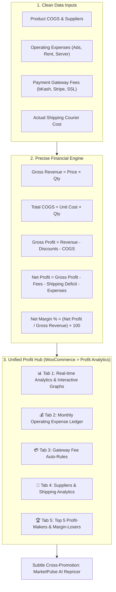

# Technical, Functional, and Implementation Plan (Comprehensive Edition)
## Simple Cost of Goods & Profit Tracker for WooCommerce

* **Product Name:** Simple Cost of Goods & Profit Tracker for WooCommerce
* **Plugin Slug:** `simple-cost-of-goods-for-woocommerce`
* **Author:** NexForge AI ([usemarketpulse.com](https://usemarketpulse.com))
* **License:** GNU General Public License v2 or later (GPL-2.0+)
* **Category:** WooCommerce E-commerce Intelligence & Financial Reporting
* **PHP Compatibility:** 7.4 – 8.3+ | **WooCommerce Compatibility:** 7.0 – 9.4+ (100% HPOS Ready)

---

## 1. Executive Summary & Product Vision

### 1.1 The Market Problem & The "Anti-Clutter" Philosophy
Most financial and cost-tracking plugins in the WordPress ecosystem fail because of two extremes:
1. **The Overpriced Monoliths:** Charge \$79–\$199/year (like WooCommerce's official COGS extension or heavy ERP suites) and clutter the admin with 5+ separate top-level menus, slowing down the WordPress database.
2. **The "Freemium Traps":** Free plugins that are messy, incomplete, hide basic features (like variation support or gateway fees) behind paywalls, and overwhelm store owners with 50 unorganized checkboxes.

### 1.2 Our Solution: The "Anti-Clutter" Unified Hub
**Simple Cost of Goods & Profit Tracker** is engineered with an **"Apple-like" clean UX**:
* **Zero Admin Sidebar Pollution:** No separate top-level menus. Everything is tucked cleanly under native WooCommerce menus: `WooCommerce > Profit Analytics`.
* **Progressive Disclosure:** Beginners only need to enter a product's cost price; everything else works automatically. Advanced merchants can progressively configure gateway fees, shipping deficits, and operating expenses when they are ready.
* **100% Local & Fast:** No SaaS subscription required for core financial intelligence. Serves as a credible, high-trust brand ambassador for **NexForge AI** and **MarketPulse**.



---

## 2. Core Mathematical Calculation Engine

Every financial report in the plugin must follow strict financial accounting principles:

| সূচক (Metric) | গাণিতিক ফর্মুলা (Exact Formula) | বিবরণ ও প্রয়োগ |
| :--- | :--- | :--- |
| **Gross Revenue** | $$\text{Gross Revenue} = \text{Product Price} \times \text{Quantity Sold}$$ | ট্যাক্স, ডিসকাউন্ট বা শিপিং বাদ দেওয়ার আগের মোট বিক্রি। |
| **Total COGS** | $$\text{Total COGS} = \sum (\text{Unit COGS} \times \text{Quantity})$$ | বিক্রি হওয়া পণ্যের মোট ক্রয়মূল্য বা উৎপাদন খরচ। |
| **Gross Profit** | $$\text{Gross Profit} = \text{Gross Revenue} - \text{Discounts} - \text{Total COGS}$$ | পণ্য বিক্রি থেকে প্রাথমিক লাভ (গেটওয়ে ও পরিচালন খরচ বাদ দেওয়ার আগে)। |
| **Payment Gateway Fee** | $$\text{Gateway Fee} = (\text{Order Total} \times \%) + \text{Fixed Fee}$$ | bKash (১.৫%), SSLCommerz (২.৫%), Stripe (২.৯% + $০.৩০) ট্রানজেকশন ফি। |
| **Shipping Deficit / Profit** | $$\text{Shipping Deficit} = \text{Actual Courier Cost} - \text{Customer Paid Shipping}$$ | কুরিয়ারের প্রকৃত খরচ যদি কাস্টমারের দেওয়া চার্জের চেয়ে বেশি হয় তবে তা খরচ। |
| **Operating Expenses** | $$\text{Operating Expenses} = \sum (\text{Ads} + \text{Rent} + \text{Salaries} + \text{SaaS})$$ | নির্দিষ্ট সময়কালের জন্য ব্যবসার ক্যাটাগরি-ভিত্তিক ফিক্সড পরিচালন খরচ। |
| **True Net Profit** | $$\text{Net Profit} = \text{Gross Profit} - \text{Payment Fees} - \text{Shipping Deficit} - \text{Operating Expenses}$$ | সব ধরণের খরচ ও চার্জ বাদ দেওয়ার পর পকেটে থাকা প্রকৃত লাভ। |
| **Net Profit Margin (%)** | $$\text{Net Margin (\%)} = \left( \frac{\text{Net Profit}}{\text{Gross Revenue}} \right) \times 100$$ | ব্যবসার কার্যক্ষমতা এবং নিট লাভজনকতার শতকরা হার। |

---

## 3. Deep User Experience (UX) & Information Architecture

To guarantee the user never feels the plugin is messy ("অগোছালো"), we implement a strict **Single-Surface UX Pattern**:

```
WordPress Admin
└── WooCommerce
    ├── Orders (Includes Net Profit badge column & Order Profit Breakdown box)
    ├── Products (Includes Cost, Margin %, Supplier & Quick Edit)
    └── Profit Analytics (⭐ Unified Central Hub)
        ├── [Tab 1] Overview & Interactive Charts (Today, 7D, 30D, Custom)
        ├── [Tab 2] Product Profit Leaderboard (Top 5 Best vs Bottom 5 Worst)
        ├── [Tab 3] Operating Expense Manager (Ads, Rent, Server Ledger)
        ├── [Tab 4] Payment Gateway Fee Rules (bKash, SSL, Stripe, COD)
        └── [Tab 5] Supplier Directory & CSV Import/Export
```

### 3.1 Visual Hierarchy & Cleanliness Rules
1. **Never Create Top-Level WordPress Sidebar Menus:** Keep the WordPress navigation clean; store owners despise plugins that insert unnecessary top-level icons.
2. **Tabbed Unified Submenu (`WooCommerce > Profit Analytics`):** Consolidate all reporting, expenses, gateway rules, and supplier management into one elegant, tabbed administrative interface.
3. **Harmonious Native Design:** All UI components use WooCommerce/Gutenberg color variables (`#2271b1` primary, `#f0f0f1` backgrounds, `#10b981` emerald green for healthy profits, `#f59e0b` amber, `#ef4444` red for losses).
4. **Zero Frontend Script Footprint:** Absolutely zero CSS/JS is loaded on the customer-facing storefront. Admin scripts are only loaded on WooCommerce screens.

---

## 4. Functional Specifications by Module

### Module 1: Data Input & Catalog Management
* **1.1 Product-Level COGS:**
  * Simple Products: Clean `Cost Price (COGS)` field in the *General* pricing tab with live margin preview.
  * Variable Products: Integrated into each variation row with individual cost tracking.
  * Quick Edit & Bulk Edit: Inline cost editing without leaving the product table list.
* **1.2 Supplier Management:**
  * Add a `Supplier` field on product edit screens (e.g., "Supplier A", "Chittagong Wholesale").
  * Filter products by supplier in the product list table.
* **1.3 Bulk CSV Import/Export:**
  * Hooks into WooCommerce native Product CSV Importer and Exporter.
  * Adds `Cost of Goods` and `Supplier` columns to native CSV files, enabling 1-click bulk updates for thousands of products via Excel or Google Sheets.

### Module 2: Order-Level Financial Breakdown
* **2.1 Line Item Cost Snapshotting:**
  * Locks unit cost at the time of purchase (`_cogs_item_cost`) so future supplier price updates never distort historical order records.
* **2.2 Order Financial Waterfall (Sidebar Meta Box):**
  * Clear vertical step-down calculation:
    ```text
    + Gross Revenue:        $120.00
    - Total COGS:           -$50.00
    ---------------------------------
    = Gross Profit:          $70.00 (58.3%)
    - Payment Fee (Stripe):  -$3.78
    - Shipping Deficit:      -$2.00 ($10 courier - $8 charged)
    ---------------------------------
    = True Net Profit:       $64.22 (53.5% Margin)
    ```
* **2.3 Actual Shipping Courier Cost Field:**
  * Inside each order, merchants can record actual courier costs (e.g., Steadfast, Pathao, RedX, DHL, FedEx) to calculate shipping deficit/surplus automatically.

### Module 3: Payment Gateway Fee Automation
* **3.1 Gateway Fee Rule Engine:**
  * Detects all installed and active WooCommerce payment methods automatically (e.g., bKash, Nagad, SSLCommerz, Shurjopay, Stripe, PayPal, Cash on Delivery).
  * Allows setting a **Percentage Fee (%)** and a **Fixed Fee ($/৳)** per gateway:
    * *bKash Merchant:* 1.5% + 0.00
    * *Nagad:* 1.2% + 0.00
    * *SSLCommerz:* 2.5% + 0.00
    * *Stripe Card:* 2.9% + $0.30
    * *Cash on Delivery (COD):* 0.0% + 0.00
* **3.2 Automatic Application:**
  * Calculates and logs the gateway fee on order creation without requiring manual data entry.

### Module 4: Operating Expense Manager (Business Fixed Costs)
* **4.1 Expense Ledger:**
  * Record non-product operational expenses:
    * Facebook / Google Advertising
    * Domain, Hosting & Server infrastructure
    * Employee salaries & freelancer fees
    * Office rent, packaging supplies & utilities
* **4.2 Monthly Net Allocation:**
  * Automatically apportions monthly operating expenses against the store's monthly gross profit to reveal actual take-home net profit.

### Module 5: Executive Dashboard & Product Leaderboards
* **5.1 Real-Time Interactive Profit Overview:**
  * Quick filter toggles: **Today**, **Yesterday**, **Last 7 Days**, **This Month**, **Last Month**, and **Custom Date Range**.
  * Pure SVG / Lightweight Canvas charts showing daily Revenue vs. COGS vs. Net Profit.
* **5.2 Product Profit Leaderboard:**
  * **Top 5 Profit-Makers:** Products generating the highest total net profit dollars.
  * **Top 5 Margin-Losers / Dead Stock:** Products with negative profit margins or zero sales velocity.

---

## 5. Technical Architecture & Data Model

### 5.1 Database Storage (100% Native, Zero Bloat)
The plugin strictly avoids creating unnecessary custom tables for orders and products. For operating expenses, a single lightweight table `wp_scogs_expenses` is created.

```sql
-- Operating Expenses Table (Lightweight & Indexed)
CREATE TABLE `wp_scogs_expenses` (
    `id` BIGINT(20) UNSIGNED NOT NULL AUTO_INCREMENT,
    `expense_date` DATE NOT NULL,
    `category` VARCHAR(50) NOT NULL,
    `title` VARCHAR(255) NOT NULL,
    `amount` DECIMAL(10,2) NOT NULL DEFAULT '0.00',
    `notes` TEXT NULL,
    `created_at` DATETIME NOT NULL,
    PRIMARY KEY (`id`),
    KEY `idx_expense_date` (`expense_date`)
) ENGINE=InnoDB DEFAULT CHARSET=utf8mb4;
```

### 5.2 Metadata Key Directory

| Entity | Meta Key | Storage | Description |
| :--- | :--- | :--- | :--- |
| **Product** | `_cogs_cost_price` | `wp_postmeta` | Unit cost price |
| **Product** | `_cogs_supplier` | `wp_postmeta` | Supplier name or ID |
| **Order Item** | `_cogs_item_cost` | `wp_woocommerce_order_itemmeta` | Line-item cost snapshot at purchase |
| **Order** | `_cogs_order_total_cost` | `wp_wc_orders_meta` / `postmeta` | Total order COGS |
| **Order** | `_cogs_gateway_fee` | `wp_wc_orders_meta` / `postmeta` | Deducted payment gateway fee |
| **Order** | `_cogs_actual_shipping_cost` | `wp_wc_orders_meta` / `postmeta` | Actual courier cost paid by store |
| **Order** | `_cogs_shipping_deficit` | `wp_wc_orders_meta` / `postmeta` | Actual shipping minus customer shipping |
| **Order** | `_cogs_order_net_profit` | `wp_wc_orders_meta` / `postmeta` | True Net Profit |
| **Order** | `_cogs_order_margin_percentage`| `wp_wc_orders_meta` / `postmeta` | Net margin percentage |

---

## 6. Implementation Milestones


### Milestone 1: Core MVP & HPOS Foundation (Status: ✅ Completed)
* [x] Standalone git repository initialized at `D:\Project\simple-cost-of-goods-for-woocommerce`.
* [x] Simple and Variable product COGS input fields.
* [x] Basic order snapshotting and HPOS compatibility.
* [x] Color-coded badges in order and product admin tables.

### Milestone 2: Mathematical Core & Gateway Fees (Status: ✅ Completed)
* [x] Create `class-cogs-calculations.php`: Centralized financial calculation engine implementing the 5 exact mathematical formulas.
* [x] Create `class-cogs-gateways.php`: Payment gateway fee rule detector and automated deduction logic.
* [x] Add actual courier shipping cost input and deficit calculation in order view.

### Milestone 3: Expense Manager & Supplier Tracking (Status: ✅ Completed)
* [x] Create `class-cogs-expenses.php`: Database ledger for business operating costs (Ads, Rent, Server, Salaries).
* [x] Add `Supplier` field to products and filter in product table.
* [x] Add inline Quick Edit auto-population and Bulk Edit support for Cost and Supplier.

### Milestone 4: Unified Analytics Hub & Charts (Status: ✅ Completed)
* [x] Create `class-cogs-reports.php`: Dedicated `WooCommerce > Profit Analytics` page with sleek tabs.
* [x] Implement date filter (Today, 7D, 30D, Custom) and lightweight interactive pure SVG daily performance charts.
* [x] Implement Top 5 Profit-Makers and Bottom 5 Margin-Losers leaderboard.

### Milestone 5: CSV Tools & WordPress.org Packaging (Status: ✅ Completed)
* [x] Create `class-cogs-csv.php`: WooCommerce Native CSV export/import hooks for COGS and Supplier.
* [x] Generate translation template (`languages/simple-cost-of-goods-for-woocommerce.pot`).
* [x] Update WordPress.org `readme.txt` and `README.md` documentation.
