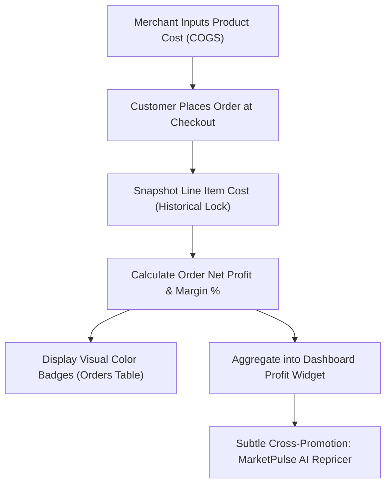

# Technical, Functional, and Implementation Plan
## Simple Cost of Goods & Profit Tracker for WooCommerce

* **Product Name:** Simple Cost of Goods & Profit Tracker for WooCommerce
* **Plugin Slug:** `simple-cost-of-goods-for-woocommerce`
* **Author:** NexForge AI ([usemarketpulse.com](https://usemarketpulse.com))
* **License:** GNU General Public License v2 or later (GPL-2.0+)
* **Target Audience:** WooCommerce store owners, e-commerce managers, and drop-shippers seeking accurate net profit tracking without paying $79–$199/yr for bloated ERP tools.

---

## 1. Executive Summary & Product Vision

### 1.1 The Market Problem
WooCommerce by default only tracks top-line gross revenue. Store owners can see they made \$10,000 in sales, but they have no native visibility into whether they actually pocketed \$4,000 or lost \$500 after product acquisition costs. 

Existing solutions in the WordPress ecosystem suffer from three critical flaws:
1. **Predatory Pricing:** The official WooCommerce Cost of Goods extension costs **\$79/year**, while third-party options range up to \$199/year.
2. **Feature Bloat:** Most free alternatives force users into heavy, multi-megabyte accounting suites with endless database tables and unsolicited admin banners.
3. **Legacy Fragility:** Many older plugins fail or trigger fatal database errors on WooCommerce 8.0+ when **High-Performance Order Storage (HPOS)** is enabled.

### 1.2 Our Solution & Mission
**Simple Cost of Goods & Profit Tracker** does one essential job with mathematical precision, zero database bloat, and modern architecture. It operates **100% locally on standard WordPress**, requires no external SaaS dependencies, and serves as an authentic top-of-funnel brand asset for **NexForge AI** and **MarketPulse**.



---

## 2. Functional Specifications

### 2.1 Product Catalog Management
* **Simple Products:** Adds a dedicated `Cost Price (COGS)` field directly inside the native WooCommerce *General* pricing panel.
* **Variable Products:** Adds `Cost Price (COGS)` to each individual product variation row under `woocommerce_variation_options_pricing`.
* **Live Margin Preview:** Computes and displays estimated unit profit and gross margin percentage in real-time beneath the price fields.
* **Product Table Columns:** Injects `Cost` and `Margin %` into `WooCommerce > Products`, allowing store owners to spot unassigned or low-margin items instantly.
* **Quick Edit Support:** Enables inline updating of wholesale cost prices without loading the full product editor.

### 2.2 Order Processing & Historical Cost Snapshotting
* **Line Item Cost Snapshotting:** When an order is created, the product's unit cost at that exact second is snapshotted onto line item metadata (`_cogs_item_cost`).
* **Supplier Price Fluctuation Protection:** If a supplier increases wholesale costs next month, historical order profit analytics remain 100% accurate and untainted.
* **Order Profit Summary Meta Box:** Displays a high-contrast executive breakdown on both Classic and HPOS order screens:
  * Total Order Revenue (Subtotal + optional shipping/tax)
  * Cost of Goods (COGS)
  * Net Profit ($)
  * Net Margin (%)
* **Visual Margin Tiers (Color Badging):**
  * 🟢 **Green (30%+ Margin):** High-margin, profitable orders.
  * 🟡 **Amber (15% - 30% Margin):** Standard margins.
  * 🔴 **Red (<15% Margin / Net Loss):** Low-margin or loss-making transactions.

### 2.3 Executive Dashboard & Reporting
* **Executive Summary Widget:** Adds a native WordPress Dashboard card displaying:
  * Today's Net Profit, Revenue, and Margin %
  * This Month's Net Profit, Revenue, and Margin %
* **Performance Caching:** Results are cached using the WordPress Transient API for 10 minutes to eliminate repetitive SQL aggregations on high-traffic sites.

### 2.4 Marketing & Brand Strategy (Trojan Horse Funnel)
* **Author Attribution:** Clear author backlinks to `https://usemarketpulse.com` across WordPress.org, plugins list, and action links.
* **Contextual Value Nudges:** A minimal, non-intrusive card in the dashboard widget:
  > *"Safeguard Your Profit Margin Floor Automatically — Are competitor price wars eroding your margins? MarketPulse monitors 100+ marketplaces 24/7 and auto-reprices your catalog while strictly protecting your minimum cost margins."*
* **Zero Hostile Upsells:** No locked core features, no countdown timers, no intrusive full-page popups. Positive merchant goodwill drives 5-star reviews and brand trust.

---

## 3. Technical Architecture & Data Model

### 3.1 Metadata Architecture

The plugin strictly avoids creating custom database tables. It stores all data inside standard WooCommerce metadata structures, ensuring total compatibility with backup tools, staging environments, and database optimization suites.

| Entity | Meta Key | Storage Location | Data Type | Description |
| :--- | :--- | :--- | :--- | :--- |
| **Product** | `_cogs_cost_price` | `wp_postmeta` | `DECIMAL(10,2)` | Unit wholesale cost price for simple or variation product |
| **Order Item** | `_cogs_item_cost` | `wp_woocommerce_order_itemmeta` | `DECIMAL(10,2)` | Unit cost snapshot at the time of purchase |
| **Order** | `_cogs_order_total_cost` | `wp_wc_orders_meta` / `wp_postmeta` | `DECIMAL(10,2)` | Aggregate cost across all order line items |
| **Order** | `_cogs_order_net_profit` | `wp_wc_orders_meta` / `wp_postmeta` | `DECIMAL(10,2)` | Order Net Profit (`Revenue - Cost`) |
| **Order** | `_cogs_order_margin_percentage` | `wp_wc_orders_meta` / `wp_postmeta` | `FLOAT` | Profit margin percentage |

### 3.2 HPOS Compatibility Engine
The plugin natively implements WooCommerce High-Performance Order Storage (HPOS) compatibility:
```php
add_action( 'before_woocommerce_init', function () {
    if ( class_exists( \Automattic\WooCommerce\Utilities\FeaturesUtil::class ) ) {
        \Automattic\WooCommerce\Utilities\FeaturesUtil::declare_compatibility(
            'custom_order_tables',
            __FILE__,
            true
        );
    }
} );
```
Both Classic `shop_order` post-type hooks and modern `woocommerce_page_wc-orders` screen hooks are simultaneously supported without deprecation warnings.

### 3.3 File & Directory Hierarchy
```text
simple-cost-of-goods-for-woocommerce/
├── assets/
│   ├── css/
│   │   └── admin-style.css          # Scoped modern styles for badges and cards
│   └── js/                          # Reserved for quick inline calculators
├── includes/
│   ├── class-cogs-product.php       # Product cost fields, quick edit, product columns
│   ├── class-cogs-order.php         # Order calculation, snapshots, HPOS order screens
│   ├── class-cogs-dashboard.php     # Cached executive profit dashboard widget
│   └── class-cogs-settings.php      # WooCommerce Settings > Products > COGS panel
├── languages/                       # Internationalization (.pot translation template)
├── .gitignore                       # Clean Git configuration
├── README.md                        # Developer & GitHub documentation
├── readme.txt                       # Official WordPress.org directory format
├── simple-cost-of-goods-for-woocommerce.php # Plugin bootstrap & singleton loader
└── uninstall.php                    # Clean uninstall routine (GDPR / WP standards)
```

### 3.4 Performance & Asset Enqueueing Rules
* **Zero Frontend Loading:** Scripts and stylesheets are completely omitted on the public storefront. Customer page speed (LCP, FID, CLS) is 100% unaffected.
* **Targeted Admin Injection:** `admin_enqueue_scripts` validates the active admin screen and only loads styles on `product`, `edit-product`, `shop_order`, `wc-orders`, and `dashboard`.

---

## 4. Implementation Plan & Milestones


### Milestone 1: Core MVP Engine (Completed — v1.0.0)
* [x] Scaffold standalone Git repo at `D:\Project\simple-cost-of-goods-for-woocommerce`.
* [x] Implement Simple and Variable product cost fields.
* [x] Implement checkout line-item cost snapshotting.
* [x] Implement Order profit calculation and color badges.
* [x] Implement cached Dashboard profit widget.
* [x] Implement WooCommerce Settings panel for shipping/tax inclusion.
* [x] Verify HPOS (`custom_order_tables`) compatibility.
* [x] Sync to local test environment (`Local Sites/marketpulse-testlocal`).

### Milestone 2: Bulk Tools & CSV Import/Export (v1.1.0)
* [ ] Integrate with native WooCommerce Product CSV Importer and Exporter to include `_cogs_cost_price` automatically.
* [ ] Bulk Edit action in product table: "Set cost price to X% of regular price" for fast store setup.

### Milestone 3: Profit Analytics Export & Date Filtering (v1.2.0)
* [ ] Date-range profit export (Download CSV of Net Profit by Day/Week/Month).
* [ ] Product profit leaderboard: Top 10 most profitable products vs. lowest margin products.

### Milestone 4: WordPress.org Public Listing & Marketing
* [ ] Generate WordPress.org official banner (772x250 & 1544x500 retina).
* [ ] Generate icon assets (128x128 & 256x256 retina).
* [ ] Create public GitHub repo `NexForge-AI/simple-cost-of-goods-for-woocommerce`.
* [ ] Submit plugin for official review on the WordPress.org Plugin Directory.

---

## 5. Security & Code Quality Standards

1. **Direct Access Protection:** Every PHP file starts with `defined( 'ABSPATH' ) || exit;`.
2. **Strict Sanitization:** Input prices are filtered through `wc_clean()` and normalized with `wc_format_decimal()`.
3. **Escaped Outputs:** All dynamic values in HTML use `esc_html()`, `esc_attr()`, or `wc_price()`.
4. **Access Control:** All modifications require the `manage_woocommerce` capability.
5. **Clean Uninstallation:** `uninstall.php` removes plugin options and transients without leaving orphan configurations behind.
